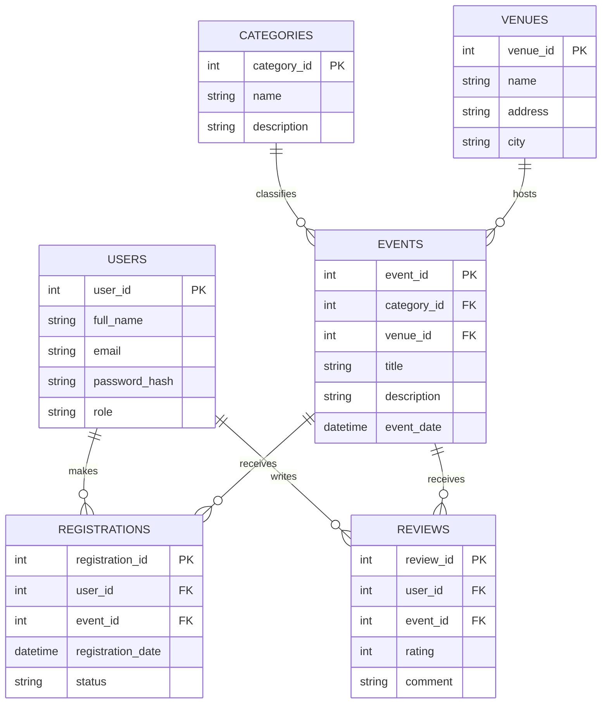

# Event Management System — ERD Draft

## Entities and Relationships

## Notes

- `PK` means Primary Key.
- `FK` means Foreign Key.
- One event belongs to one category and one venue.
- Users can register for multiple events.
- An event can have multiple registrations and reviews.
- This is a preliminary design for Milestone 1. The schema may be refined before database implementation.
